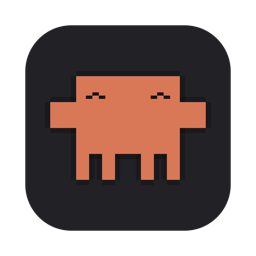
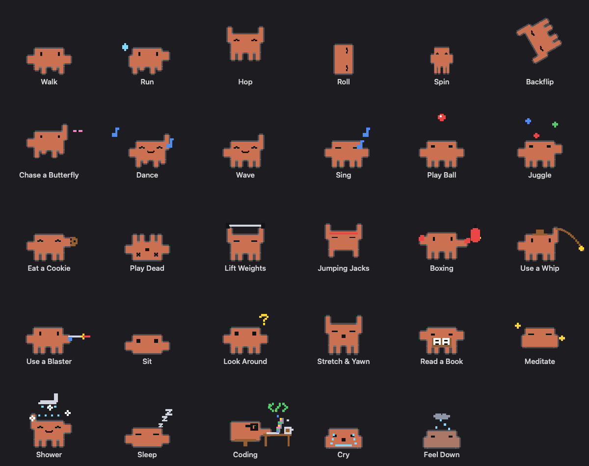
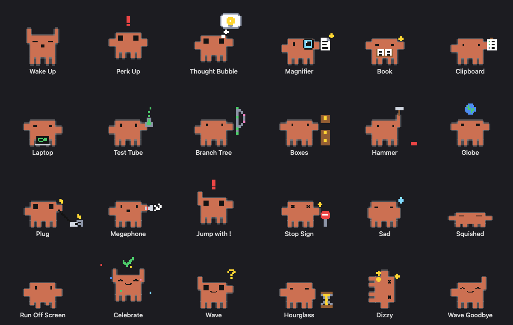

<p align="center">
  
</p>

<h1 align="center">Claudinion</h1>

<p align="center">
  <b>A tiny pixel minion that lives on your Mac desktop and acts out what Claude Code is doing.</b><br>
  It types when Claude runs commands, hammers when it edits files, jumps up and down when Claude needs you,<br>
  and when Claude is idle it walks, dances, juggles, showers, naps… 29 things in all.
</p>

<p align="center">
  
  
  
  
</p>

> [!NOTE]
> Claudinion is an unofficial fan project. It is not made by, affiliated with, or endorsed by Anthropic.
> "Claude" and "Claude Code" are trademarks of Anthropic.

---

## Contents

- [What it does](#what-it-does)
- [Install](#install)
- [Connect it to Claude Code](#connect-it-to-claude-code)
- [Using it](#using-it)
- [All actions](#all-actions)
- [How it works](#how-it-works)
- [Troubleshooting](#troubleshooting)
- [Uninstall](#uninstall)
- [Development](#development)
- [License](#license)

## What it does

- 🧡 **Lives on your desktop.** It walks along the bottom of your screen (or an area you choose), stays on top of other windows and shows up on every Space.
- 🤖 **Reacts to Claude Code in real time.** It uses [Claude Code hooks](https://code.claude.com/docs/en/hooks), so it works in the terminal and in the Claude desktop app's Code tab.
- 🎲 **Has 29 idle actions** in 6 categories, and you choose which ones it may do.
- 🎛️ **Is easy to adjust.** Pick a theme (Classic orange, Charcoal with an orange glow, or a Shadow silhouette), change its size and speed, follow macOS light/dark mode, set where it walks, and hide it from the menu bar.
- 🪶 **Is tiny and private.** It's a single Swift file with no dependencies. It only ever sees the *names* of Claude's events and tools, and its only network request is the update check to GitHub, which you can turn off.

<p align="center">
  
</p>

## Install

Claudinion needs **macOS 14 (Sonoma) or later**, on an Apple silicon or Intel Mac.

### Option 1: Download (easiest)

1. Download **`Claudinion.zip`** from the [latest release](https://github.com/tarek-89/Claudinion/releases/latest).
2. Unzip it and move **Claudinion.app** into **Applications**, or into the Applications folder in your home folder.
3. Claudinion isn't signed with a paid Apple Developer ID, so macOS blocks it the first time. Clear that once in Terminal (adjust the path if you put the app elsewhere):

   ```bash
   xattr -dr com.apple.quarantine /Applications/Claudinion.app
   ```

4. Open Claudinion.

### Option 2: Build from source

You'll need the **Xcode Command Line Tools**. If you don't have them yet, run `xcode-select --install`. Then:

```bash
git clone https://github.com/tarek-89/Claudinion.git
cd Claudinion
./build.sh --install
```

This builds a universal app, copies it to `~/Applications/Claudinion.app` and starts it. If you only want to build it, run `./build.sh` and the app appears in `build/Claudinion.app`.

Either way, your minion pops up at the bottom of the screen, and a small pixel icon appears in the menu bar.

> [!TIP]
> To start Claudinion automatically whenever you log in, tick **Start Claudinion when you log in** in **Settings…**.

### Updating

Claudinion checks GitHub for a new release once at launch and then once a day. When one is out, the menu shows **Update to vX.Y.Z…**. Click it and Claudinion downloads the new version, replaces itself and restarts. Your settings and Claude connection are kept.

- To check right away, choose **Check for Updates…**.
- To turn off automatic checks, untick **Check for updates automatically** in **Settings…**.
- If you built from source, you can also update with `git pull && ./build.sh --install`.

## Connect it to Claude Code

Claudinion plays on its own straight away. To make it react to Claude:

1. Click the Claudinion icon in the menu bar (or right-click the minion).
2. Choose **Connect to Claude…** and confirm.
3. Start a **new** Claude Code session. Sessions that are already open won't send events.

**What Connect does:**
- It adds a small hook entry to `~/.claude/settings.json` for each event listed under [How it works](#how-it-works).
- It saves your previous settings as `~/.claude/settings.json.before-claudinion` first.
- It doesn't touch any hooks you already have.

To undo it, choose **Disconnect from Claude…**. That removes only Claudinion's hooks.

If a newer version of Claudinion uses extra events, the menu shows **Update Claude Connection…** instead. One click brings your hooks up to date.

<details>
<summary>Prefer to edit the settings by hand?</summary>

Add this to the `hooks` section of `~/.claude/settings.json`. Repeat it for each event name listed in [How it works](#how-it-works):

```json
{
  "hooks": {
    "PreToolUse": [
      {
        "hooks": [
          {
            "type": "command",
            "command": "\"$HOME/Applications/Claudinion.app/Contents/MacOS/Claudinion\" --hook",
            "async": true
          }
        ]
      }
    ]
  }
}
```

`async: true` means Claude never waits for the minion.
</details>

## Using it

| You do | Claudinion does |
|---|---|
| **Click** it | Hops with a heart, or does your chosen click action, and plays your click sound |
| **Double-click** it | Backflip |
| **Drag** it | Dangles from your cursor; drop it anywhere, for example on top of a window. With a custom walking area, the area is outlined while you drag: orange when it's over the area, red when it's outside and will snap back |
| **Right-click** it, or click the **menu bar icon** | Opens the menu |

**The menu:**

| Item | What it's for |
|---|---|
| **Status line** (top) | What the minion is doing right now, like "Claude: Editing files" or "Playing: Juggle". The dot is green while Claude is busy |
| **Play ▸** | Starts any action now, including previews of every Claude reaction |
| **Theme ▸** | **Classic** (orange, the default), **Charcoal** (dark with an orange glow) or **Shadow** (a dark silhouette), each with a little preview |
| **Walking Area ▸** | **Anywhere** (the bottom of the screen), **Custom Area**, or **Draw New Area…**: drag a rectangle and it walks along that rectangle's bottom edge |
| **Click Action ▸** | What a single click does: **Default** (hop with a heart), **Random**, or any of the 29 actions |
| **Click Sound ▸** | **Off**, **Random**, one of your own sounds, or a built-in macOS sound. Picking one plays a preview |
| **Stay in Place** | It still animates, but stops walking around |
| **Hide / Show Pet** | Hides the minion without quitting it |
| **Claude ▸** | Shows whether it's connected, plus **React to Claude** and **Connect / Update / Disconnect…** |
| **Settings…** | Theme, size, speed, click action, click sound and volume, light/dark, walking area, start at login, update checks, and which actions it does on its own |
| **Check for Updates… / Update to vX.Y.Z…** | Checks GitHub for a new version, or installs one that's available |

**Click sounds:** the default is macOS's **Pop**. To use your own, choose **Click Sound ▸ Open Sounds Folder…** and drop in `.mp3`, `.wav`, `.m4a`, `.aiff` or `.caf` files. They appear under **My Sounds** straight away. The folder is `~/Library/Application Support/Claudinion/Sounds`, and you can set the volume in **Settings…**.

Your settings (size, appearance, walking area, chosen actions) are saved and come back every time it starts.

## All actions

### Idle actions

These are what it does when Claude isn't busy. In **Settings…**, untick the ones you don't want. If you leave just five ticked, it rotates between those five.

| Category | Actions |
|---|---|
| **Moving** | Walk · Run · Hop · Roll · Spin · Backflip · Chase a Butterfly |
| **Fun** | Dance · Wave · Sing · Play Ball · Juggle · Eat a Cookie · Play Dead |
| **Sports** | Lift Weights · Jumping Jacks · Boxing · Use a Whip · Use a Blaster |
| **Chill** | Sit · Look Around · Stretch & Yawn · Read a Book · Meditate · Shower · Sleep |
| **Work** | Coding |
| **Moods** | Cry · Feel Down |

### Claude reactions

These play automatically while Claude works, and they always take priority over idle actions.

<p align="center">
  
</p>

| When Claude… | Claudinion… |
|---|---|
| starts a session | wakes up, stretches and hops |
| gets your message | perks up with a **!** |
| is thinking | paces and taps its chin; a thought bubble cycles through **…**, a turning gear, **?** and a light bulb 💡 |
| reads or searches files | holds a magnifier to its eye, then finds a document with a highlighted line |
| loads a skill | studies a book, with sparkles |
| plans or updates its to-do list | ticks boxes on a clipboard |
| runs shell commands | types on a little laptop |
| runs tests | shakes a bubbling test tube |
| uses git | grows a branch tree, commit by commit |
| installs packages or builds | catches falling parcels and stacks them |
| edits or writes files | hammers a brick, with sparks |
| uses the web | holds up a spinning globe |
| uses an MCP tool | plugs a cable into a socket, which buzzes with power |
| starts a subagent | calls out orders through a megaphone; helper clones walk beside it while subagents run |
| needs your permission or an answer | jumps and waves with a flashing **!** |
| has an action blocked | walks into a stop sign, bounces back and shakes its head |
| has a tool fail | shakes, sad and sweaty |
| compacts its context | gets squished flat, then pops back up |
| completes a task | shows a ✓ |
| changes folder | runs off one edge and comes back from the other |
| finishes its turn | celebrates with a ✓ and confetti |
| is waiting for your reply | waves at you with a **?**: your turn |
| hits a rate limit | sits by an hourglass, tapping its foot |
| hits another API error | falls over dizzy |
| ends the session | waves goodbye and goes to sleep |

## How it works

```
Claude Code ──hook──▶ Claudinion --hook ──append──▶ ~/.claude/claudinion/events.jsonl ──watch──▶ Claudinion (on screen)
```

- **Two modes, one binary.** When Claude Code fires a hook, it runs the same app binary in a short-lived `--hook` mode. That process reads the hook's JSON from stdin and appends one line to `~/.claude/claudinion/events.jsonl`. The line holds only the event name, the tool name, the notification or error type, the session id and a timestamp. For shell commands it keeps a single category word (`git`, `test`, `install` or `build`), never the command itself.
- **Watching the file.** The running minion reads new lines from that file a few times per second and switches animation.
- **Never slows Claude down.** The hooks are `async`, so Claude doesn't wait for them, and the event file is trimmed automatically when it grows past 512 KB.
- **Safety timeout.** If Claude goes quiet for 10 minutes in the middle of a task (for example, a session was closed), the minion goes back to playing.

**Hook events used:** `SessionStart`, `UserPromptSubmit`, `PreToolUse`, `PostToolUse`, `PostToolUseFailure`, `PermissionRequest`, `PermissionDenied`, `Notification`, `SubagentStart`, `SubagentStop`, `Stop`, `StopFailure`, `PreCompact`, `PostCompact`, `TaskCompleted`, `CwdChanged`, `SessionEnd`.

## Troubleshooting

<details>
<summary><b>It doesn't react to Claude</b></summary>

- Make sure the menu says **Disconnect from Claude…**. If it says Connect, it isn't connected yet.
- Start a **new** Claude Code session after connecting.
- Check that **React to Claude** is ticked.
- Run `tail -f ~/.claude/claudinion/events.jsonl` while you use Claude. New lines should appear.
- Cloud sessions run on remote machines, so they can't reach the minion on your Mac. Local sessions in the terminal and the desktop app's Code tab work.
- If you moved the app after connecting, choose **Disconnect** and then **Connect** again, so the hooks point to the new location.
</details>

<details>
<summary><b>I can't find the menu bar icon</b></summary>

On a crowded menu bar, macOS may hide new icons behind the notch. Quit a few menu bar apps, or use a menu bar manager. You can always right-click the minion itself.
</details>

<details>
<summary><b>macOS says the app is damaged or from an unidentified developer</b></summary>

This happens to prebuilt copies that were downloaded rather than built locally. Either build it yourself with `./build.sh`, or clear the quarantine flag:

```bash
xattr -dr com.apple.quarantine ~/Applications/Claudinion.app
```
</details>

## Uninstall

1. From the menu, choose **Disconnect from Claude…**, then **Quit**.
2. Remove the app, its event file and its saved settings:

```bash
rm -rf ~/Applications/Claudinion.app ~/.claude/claudinion && defaults delete io.github.tarek-89.claudinion
```

## Development

The whole app is one file, [`Sources/Claudinion/main.swift`](Sources/Claudinion/main.swift), built with plain `swiftc`. There's no Xcode project or package manager. The file is organised in this order:

| Section | What's in it |
|---|---|
| Hook mode | The `--hook` entry point that Claude Code runs |
| Look | Colours, light/dark themes, and pixel-art props drawn as small strings |
| Pose and Actions | `render(act, tick, facing)` returns the pose and props for every frame of every action |
| Drawing | The body, eyes and props, drawn on a pixel grid |
| Walking area picker | The overlay for drawing the walking area |
| Pet | The window, menus, settings, Claude event handling and the animation loop (12 fps) |

### Adding an action

1. Add a case to `enum Act`, and put it in a category in `Act.categories`.
2. Give it a `title` and a `duration()`.
3. Add a `case` in `render(_:_:_:)` that sets the pose (`p`) and adds props with `add(...)` or `addF(...)`. `addF` mirrors the prop when the minion faces left.
4. To check the art, run `./build.sh` and then:

```bash
build/Claudinion.app/Contents/MacOS/Claudinion --gallery /tmp/actions.png
```

That draws one frame of every action. Use `--gallery /tmp/r.png reactions` for the Claude reactions, and `--sheet /tmp/s.png` for several frames per action.

Pull requests with new actions are very welcome.

### Releasing a new version

1. Bump the number in [`VERSION`](VERSION), for example `1.0.0` → `1.1.0`, and commit it.
2. Run `./release.sh --publish`. This builds the app, zips it as `build/Claudinion.zip` and creates the GitHub Release `v1.1.0` with the GitHub CLI (`gh`). Without `--publish` it only builds the zip and prints the `gh` command to run.

Installed copies pick up the new release within a day, or straight away with **Check for Updates…**. The release must include an asset named exactly `Claudinion.zip`, and its version must match the tag.

## License

[MIT](LICENSE)
